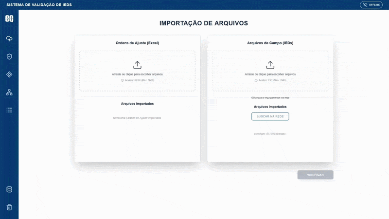

# Ferramenta de Validação de Parâmetros de IEDs
[](https://fastapi.tiangolo.com/)
[](https://www.postgresql.org/)
[](https://www.docker.com/)
[](https://reactjs.org/)  

Sistema Full-Stack de **engenharia de dados e validação automatizada** desenvolvido para o setor de automação de subestações elétricas. A plataforma automatiza a auditoria de parâmetros de IEDs (*Intelligent Electronic Devices*), comparando Ordens de Ajuste (`.XLSX`) com arquivos de configuração (`.TXT`) e arquivos de topologia de subestação (`.SCD` / IEC 61850).

---
> **Problema Resolvido:** A parametrização manual de IEDs em subestações é propensa a erros operacionais. Esta ferramenta reduz o tempo de comissionamento e auditagem ao identificar discrepâncias de parâmetros e topologia em segundos com relatórios visuais.
---


> **[Assista à demonstração completa de 2 minutos no Google Drive](https://drive.google.com/file/d/1PSjpOgDIWlvmRX3a4evXXR2UbXrjw1yf/view?usp=sharing)**

### Funcionalidades de Backend & Dados:
- **Pipeline de Parsing Heterogêneo:** Ingestão e cruzamento de dados de arquivos não estruturados (`TXT`), planilhas (`XLSX`) e arquivos XML estruturados em padrão de subestação (`SCD`).
- **Engine de Comparação de Parâmetros:** Algoritmo que varre chaves e valores esperados vs. configurados, gerando uma tabela detalhada de inconsistências.
- **Validação de Topologia SCD:** Validação de esquemas e regras de negócio do arquivo da subestação frente ao formulário cadastrado pelo engenheiro.
- **Módulo de Rede:** Integração via Telnet e FTP para automação de busca de dados TXT diretamente dos dispositivos de campo.
- **Histórico & Auditoria:** Rastreabilidade de relatórios gerados via banco relacional.

## Tecnologias Utilizadas

- **Backend:** Python 3, FastAPI, Uvicorn, SQLAlchemy, Pydantic v2, OpenPyXL, PostgreSQL
- **Frontend:** React, Vite, TailwindCSS
- **Infraestrutura:** Docker, Docker Compose

### Pré-requisitos
- [Docker](https://www.docker.com/) e Docker Compose instalados.

### 1. Configuração de Variáveis de Ambiente
Crie o arquivo `.env` na raiz do projeto com base no arquivo `.env.example`:

```env
POSTGRES_PASSWORD=sua_senha_aqui
DATABASE_URL=postgresql://admin:sua_senha_aqui@db:5432/equatorial_db
```

### 2. Inicialização via Docker (Recomendado)

```bash
docker-compose up -d --build
```

## Acessos rápidos

- **Interface Web:** http://localhost:5173
- **Documentação Interativa da API (Swagger):** http://localhost:8000/docs

## Dados de Teste & Mapeamento de Rede

Para testar a importação de dados e o módulo de rede simulado:

1. Baixe o modelo da planilha: **[Modelo de Inventário](./samples/modelo_bd.xlsx)**
2. Na interface web, utilize a opção **"Importar Inventário de IEDs"** no menu lateral.
3. Para simular a coleta remota de dados por **FTP/Telnet**:
   ```bash
   pip install pyftpdlib telnetlib3
   python mocks/server_mock.py
   ```

## Estrutura do repositório

```
├── backend/            # API FastAPI, schemas Pydantic, rotas e engines de validação
├── frontend/           # Interface React (Vite) + TailwindCSS
├── mocks/              # Servidores mock FTP e Telnet para testes de rede
├── samples/            # Arquivos de exemplo da planilha para importação
├── docker-compose.yml
└── .env.example
```

## Comandos Úteis
- **Visualizar Logs:** `docker-compose logs -f`
- **Reiniciar Backend:** `docker-compose restart backend`
- **Parar aplicação:** `docker-compose down`
